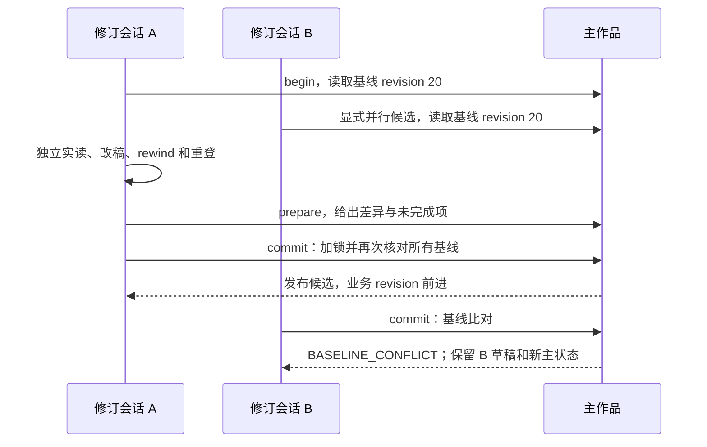

# 创作规划、作者决策与修订管理：落地设计及验收方案

更新日期：2026-10-19。当前状态：**八项需求的已确认范围已实现并已有Windows本地验证；当前0.8.1为Apache-2.0授权的本地候选，尚未正式发行**。八项对应能力、实际验证结果、实现细化和暂缓范围统一见[当前状态总览](authoring-governance-status.md)。新增创作方法及0.7/0.8兼容验证见[J轮记录](../acceptance/20261019-webnovel-reference-j/README.md)；0.8.0下112章副本恢复、修订、更新与导出范围见[H轮记录](../acceptance/20261019-hundred-h/README.md)；0.8.1许可及包兼容验证见[K轮记录](../acceptance/20261019-apache-license-k/README.md)。模型复核不代表真人文学验收。现有作品与既有封存档案不因说明维护而修改。

作者已分批授权并完成A→B→C→D。A见[0.4.0首批记录](../acceptance/20261018-governance-a/README.md)，B见[第二批实现说明](authoring-governance-b-implementation.md)及[版本修订手册](revision-and-sources.md)。C见[第三批约束](authoring-governance-c-implementation.md)及[专项手册](review-and-registration.md)。D见[D批约束](authoring-governance-d-implementation.md)、[更新手册](tool-updates.md)和[D批验证记录](../acceptance/20261018-governance-d/README.md)。E/F补强及最终0.7.3百章流程见[当前状态总览](authoring-governance-status.md)。以下需求缺口、字段草图和验收矩阵保留设计时点的依据，均有历史语境；它们不表示当前尚无对应功能，也不替代已细化的实际协议与分版本证据。

## 1. 背景、目标与非目标

需求来源为[六章试写反馈](D:/work/小说/dzkxqxx/研究/ai-writer六章试写反馈与需求-2026-10-18.md)。[核对基线](authoring-governance-baseline-20261018.json)记录反馈原文哈希、主项目 HEAD、所查源码哈希及两份工具的模块差异。它只证明本轮读取的版本，不代替后续功能测试。

六章后转回规划、作者选择散落多处、未来设定追加触发历史来源变更，以及另一个会话同时修订，暴露了工具对“当前打算做什么、谁确认了什么、哪个版本对哪章生效、谁正在改哪份稿”的表达不足。上层规划组织也属于写作执行责任，不能把已有工具保护描述为失效或完全缺失。

目标是让恢复后的代理先看到当前任务和未决问题；已确认选择有单一结构化来源；旧章来源可复现；修订全过程可隔离、比较、提交和恢复。复用现有分卷、增量账本、来源校验和滚动审查，维持本地文件与无额外运行依赖的产品形态。

非目标：不自动理解自然语言授权、不自动选定作者尚未选择的内容、不自动证明语义无影响、不自动评文学重复或评分、不引入常驻服务/数据库/额外代理、不自动升级实际作品。工具已经实现，真实作品仅作为只读反馈来源；既有实跑使用另建作品或隔离副本。

## 2. 设计时核实的历史缺口及八项需求

本节描述0.3.0设计基线及当时实施取舍；八项当前均已落地，不能把表中“无阶段”等历史缺口理解为当前状态。

| 编号 | 优先级 | 设计时实现与缺口 | 原交付目标（当前已按批次落地） |
| --- | --- | --- | --- |
| AW-01 | P0 | `workspace.mjs:467–477` 的 next 只看漂移和下一章细纲；无阶段与授权范围 | 阶段/任务/范围写入权威状态；status、context、record 共用门禁；规划时保留 next_unit=7 而行动指向规划 |
| AW-02 | P0 | 文字设定和事实 ledger 已有；作者方案的采纳与取代尚无独立模型 | 稳定决策 ID、逐项采纳、候选与取代链、原话证据；派生当前视图；未来计划不混入事实 ledger |
| AW-03 | P0 | `changedSources` 全文件校验正确；`contextPacket` 默认读取三份活动设定；已消费卷纲禁止直接覆盖 | 不可变来源版本、按单元生效、消费绑定和影响预览；历史变更须实读处置，未来新增不伪造旧章输入 |
| AW-04 | P0 | `withLock` 只覆盖单条命令，record/rewind 有修订号校验；正文在锁外可被改 | 独立修订区、长期保留的会话与范围、提交前 CAS、文件事务及中断恢复；过期分支保留 |
| AW-05 | P1 | 现有模型审查与滚动覆盖会绑定正文哈希；未结构化比较章节功能 | 目标/阻力/选择/后果/关系变化表及原文证据；只记录模型判断、保留项与不确定性 |
| AW-06 | P1 | `record-template` 已填路径、来源哈希及 schema 1 快照；schema 2 已填 changes 并保留未变项 | 提前引导长篇、迁移预览、修订输入草案与差异；不重复实现另一套增量账本 |
| AW-07 | P1 | doctor 查版本和模块存在；随附工具来自固定复制清单，无构建清单与更新事务 | 内容构建 ID、完整性/差异检查、备份及可恢复更新；同版本不同内容正确显示 |
| AW-08 | P1 | review 绑定报告及正文哈希，语言审查已有硬问题/偏好区分；无意见级处置链 | 意见 ID、采纳/保留/待定、改动绑定与版本复核；可选建议不自动升级必改 |

上述现状根据本轮源码核对。第三、四章的具体阅读问题取自反馈稿，本轮未重新逐句审稿，不能把它们计作新一轮文学复核结论。

### 2.1 重新判断优先级与责任

| 需求 | 评估归类 | 实施优先级及责任拆分 |
| --- | --- | --- |
| AW-01 | **确有工具缺口；技能已有讨论边界但恢复指引需补强** | P0、最小批次。工具存任务/范围并统一门禁；技能恢复时先看任务；执行者必须及时落实作者“暂停正文”，不能只赖 status |
| AW-02 | **作者决策管理确有缺口；正文事实管理已有** | 基础记录/逐项采纳 P0；复杂方案树和自动传播暂缓。工具保留事件与当前投影；代理负责准确摘取原话和确认范围，不凭“就按这个方向”采纳细节 |
| AW-03 | **哈希保护已有；版本固定和影响流程确有缺口** | P0、第二批。先做冻结/范围/保守影响，依赖 schema 3 和决策索引；自动语义无影响判定不做 |
| AW-04 | **revision/CAS/短锁已有；全过程隔离提交确有缺口** | P0、第二批安全核心，先于任何便利性的批量重登。范围提示和独立候选可先做，但完整能力必须等事务/恢复验收；自动合并及跨机协作暂缓 |
| AW-05 | **滚动实读和版本审查已有；功能比较需补强** | P1、技能方法可随第一批先改善，结构化记录随后。模型负责文学比较，工具只组织证据；机械重复评分不做 |
| AW-06 | **增量模板等主体能力已有；引导与修订减负需补强** | P1，先改引导，预览/回放草案待安全修订机制成熟；另造增量系统暂缓且无必要 |
| AW-07 | **模块缺失检查已有；内容身份与安全更新确有缺口** | 构建识别上调为 P0 前置，避免再次混淆验证版本；全量安全更新为 P1，复用修订事务后落地；自动联网升级不做 |
| AW-08 | **报告绑定和意见类型已有；执行闭环确有缺口** | P1、依赖稳定修订提交 ID 后完成；先用简短意见模板保留作者取舍，不引入逐句强制审批 |

因此不把八项全部当新引擎重做，也不让八项同时膨胀成一个不可验收的大版本。执行层先把全书骨架、有限试写和复盘组织提前；工具层优先确保状态指引正确、采纳范围准确和修订不覆盖他人稿；技能层继续承担实读、因果比较与语言判断。

主项目 HEAD 为 `36bd9c27797a43dd958e74b4e4b8f5b9713e140a`，工作区原有未跟踪 `.idea/`。两份 package 均为 0.3.0，本轮重算的 help/workspace/longform 三个模块哈希均不同，与反馈记录吻合；仅据版本号判断一致确实不够。没有核查远端。

## 3. 核心约束与兼容决策

1. `.writer/state.json` 继续是唯一可变业务权威。正文事实、创作治理、版本生效索引和已提交修订引用都从它恢复；可读 Markdown 是派生视图，手改视图不能反向改变作者决策。大对象和历史事件采用不可变文件，由 state 保存路径及哈希，不再增加一个需要同时更新的可变权威文件。
2. A批治理写入引入state schema3，B/C/D分别提升至4/5/6；**当前新作品默认schema6**，继续沿用baseline/journal增量链。各代旧工具拒绝其不支持的新状态，避免忽略新保护后继续写入。`writer.json`配置版本与state版本分别管理；旧作品只在明确授权下按手册迁移，不能只添加sidecar并声称旧工具也受保护。
3. 新工具继续读取 schema 1/2；没有迁移的作品显示 `governance=not-enabled`，保持原校验，不伪造作者授权或历史决策。治理命令要求先备份迁移；长篇 schema 1 可在预览中选择一起转为差量追踪，必须验证前后事实终态等价。
4. 每次业务变更（阶段、决策、版本生效、修订提交、意见处置）都使用 expected_revision 并推进统一 revision。旧登记输入因此会过期；重新读取变化后再准备，不能偷偷刷新哈希。历史单元不因 revision 前进被改写。未改变正文的治理变更不自动废掉所有正文审查。
5. 修订会话的所有者、草稿进度和互斥范围属于协作元数据；保存在独立会话文件中，通过现有命令锁串行创建/更新，不推进业务 revision。它们不能改变事实或授权；提交必须另过业务 CAS。这样 A/B 可以从同一业务 revision 开分支，又不会因 heartbeat 互相使上下文过期。
6. 所有写入入口共用阶段、修订占用、版本依赖、事务恢复和构建代次检查，包括 plan/volume/record/rewind/迁移/意见处置/更新。不能只在 status 提醒。引用与输出继续限制目录、普通文件、编码及大小，拒绝穿越和链接。
7. 源文件哈希只证明字节，作者确认只证明所声明的范围，模型复核只证明所读版本与判断。产品不得把这些升级为作者定稿、真人盲读或市场验证。
8. 并发范围首先支持同机本地文件系统；不对共享盘/NFS/跨机器宣称同等锁保证。直接编辑器或旧程序的任意写文件无法被应用锁绝对拦截；通过隔离、重复比对和失败后保留双方减少损失，不宣称排除所有锁外竞态。

## 4. 原设计数据结构与权威归属

以下是原设计协议草图。对应命令已经实现；实际协议已分批演进到schema6，准确字段、限制与动作以当前帮助、实现说明及手册为准，不以本草图宣称所有字段原样交付。

| 位置/对象 | 关键字段与约束 |
| --- | --- |
| state schema 3 | `schema_version, revision, project_id, baseline, snapshot, units`；新增 `governance, decisions, source_versions, committed_revisions, review_resolutions, tool_generation`；保留现有事实和差量语义 |
| governance | `stage, task, authorization, planning, event_ref, event_sha256`；stage 与当前正文允许范围分开，规划阶段能进行有范围的修订 |
| authorization | `id, allowed_actions, draft_range, revise_range, stop_conditions, author_evidence`；动作区分 discuss/plan/draft/revise；区间闭合；空范围不表示无限授权；到期或达到 stop_conditions 后暂停相关写动作 |
| planning | 定位、全书骨架、分卷、近期章纲各项的 `status=missing/draft/adopted/deferred, refs, unresolved_ids`；文件存在不等于 adopted；deferred 必须写明试写范围及复盘条件 |
| decisions[id] | `topic, options, adopted_items, excluded_items, unresolved_items, status, supersedes, effective_range, evidence_ref`；状态 candidate/confirmed/superseded/withdrawn；分支是多个候选项及尚未选的子问题 |
| 作者证据 | 不可变事件中的 `quote, local_source, source_sha256, locator, recorded_at, recorder`；只有能获得时才填真实 conversation/message ID；操作者登记不是密码学作者身份认证 |
| source_versions[id] | 逻辑来源、版本 ID、不可变对象路径/哈希、格式、前版、生效区间、决策 ID、影响分析引用/哈希；同一逻辑来源的有效区间不重叠，显式替代时切分旧区间并保留事件 |
| units 的消费记录 | 保留原 source_hashes；新记录另含 `source_bindings`（逻辑来源→版本 ID/路径/哈希）、实际使用的 `decision_bindings`、authorization ID、tool build ID；可验证引用本身，不把所有规划变化强加为历史事实变化 |
| `.writer/objects/` | 以内容哈希命名的不可变 UTF-8 来源、事件、影响分析、意见和提交清单；引用验证哈希；被引用对象不覆盖，未引用孤儿可盘点但不自动删除 |
| `.writer/revisions/<id>/` | 会话描述、所有者令牌摘要、base_revision/state_hash、工具构建、读取/拟写文件基线、声明范围、独立 workspace、进度、冲突报告；正文候选始终留在 workspace |
| `.writer/transactions/<id>/` | prepare 清单、旧/新文件哈希、备份对象、目标 state 哈希、事务状态和恢复信息；用于多文件发布或工具替换，不作为第二业务真相 |
| `.writer/reviews/` 及意见对象 | 复用 report/body 哈希；意见 ID 绑定原版本、定位/引文、类型、置信、建议、处置事件、修改前后哈希、复核范围和结论 |
| `.writer/tool/build-manifest.json` | 清单格式、工具版本、来源 commit、dirty 标记、相对路径/大小/哈希、内容 build_id、支持的 state schema；来源 commit 允许 unknown，不凭它代替内容校验 |

字段、ID、有效区间、事件引用都严格校验；未知字段不默默丢弃。state 仍受 64 MiB 保护，正文和普通来源仍按现有上限，context 默认 40000 字符且不静默截断。意见历史和原话不全塞进 context；默认返回当前有效摘要、未决项及可定位引用。

## 5. AW-01：阶段、任务与授权范围

stage 建议枚举 `direction / structure / volume / outline / trial / drafting / revision / paused`，允许退回任一规划阶段。stage 说明当前工作中心；allowed_actions 和范围才决定可执行动作，不把阶段枚举硬编码成唯一线性流程。

新作品先组织定位、故事承诺、全书骨架、近期卷目标和未决选择。长篇远期可以只留骨架；作者可授权 1–3 章试写并暂缓远期细节。试写到范围末尾后 next 指向复盘。不得以“有全书大纲文件”或“已经写六章”推断可以无限继续正文。

恢复输出区分 `next_unit` 与 `next.action`：六章登记后前者仍为 7；任务为总纲讨论且 draft_range 为空时，后者是“处理全书骨架与未决决策”，context 显式输出“本轮仅讨论，不写第七章”。尚无第七章细纲也应能取得讨论上下文，不能先要求准备正文细纲。拟新增 `context --purpose discussion|draft|revision`；原 `--unit` 形式继续表示 draft。

discussion 可在来源漂移时返回带阻断清单的只读诊断，不能谎称已恢复为有效续写状态。draft/revision 仍执行所需完整性门禁。拒绝 draft 时在读取大量正文前给出 `ACTION_OUT_OF_SCOPE`，同时列出 task、允许动作及剩余范围。record 与修订提交复查同一授权，防止只改 status 的表面修复。工具无法禁止模型在聊天里写正文，因此技能还要在动笔前检查任务与范围。

阶段更新必须记录作者证据，`workflow set` 本身不是作者重新授权的证明；代理不得为了通过命令自行扩大范围。更晚的明确作者指令优先，由代理据原话更新任务。以简短任务说明恢复，不反复要求作者确认已授权常规细节。

## 6. AW-02：作者决策与当前视图

每个决定解决明确问题。例：`D_SECT` 确认青岚宗方向，只采纳宗门方向；经名、住舍人数及作息数字仍未决。`D_FIRST_ART` 确认炼器先行；`D_FIRST_OBJECT` 仍候选，小盾仅 recommendation。程序要求 `adopted_items` 显式列项，禁止因引用讨论稿就推断整稿全部采纳。

已确认项的替换必须声明 supersedes 和生效范围，旧原话与旧方案对象保留。取代链禁止循环、悬空和歧义的双重当前确认。撤回也不删除历史。涉及已写事实时创建影响分析待办，不直接改 ledger 或正文。

`decision current` 默认仅投影该单元有效的确认项及相关未决项，候选单列，取代项只在 `--history` 出现。派生 Markdown 顶部标生成来源 revision/hash；手工改后只提示 regenerate，不能把它当新作者指令。AGENTS 仅保留稳定边界和入口。恢复时同时区分“作者计划”和“正文已发生事实”，二者冲突列待处置，不擅自选一方抹掉另一方。

## 7. AW-03：设定版本与影响分析

### 7.1 冻结和按章解析

`source freeze` 读取来源，生成不可变对象及版本提案；`source publish` 在影响预览通过人工/模型实读并有明确授权范围后发布生效。新 context 按逻辑来源、单元、版本索引解析；每个单元保存实际消费的对象路径及哈希。默认三份设定与 plan/volume 引用必须走同一解析层，不能只为额外 setting_refs 实现版本化。

活动 Markdown 是编辑入口或视图。已登记单元持续校验其不可变输入；入口文件更改只形成待发布差异，不自动切换到新内容。不可变对象被改、缺失或替换仍报错，不能以“这是新版本”消除漂移。研究事实卡保留类型与证据检查，冻结不把未核实资料升级为 verified。

旧单元只有 live source_hashes 时继续原保护。显式补充历史版本绑定，只能冻结**与原消费哈希完全一致**的字节，保留原哈希和旧绑定证据；若原文件已变，要求找回可核旧版或走保守修订，禁止冻结当前文件并追认旧章用过它。正文间承接、writer 配置等普通依赖仍按原规则校验。

成功补充版本绑定后，持续校验该条消费的冻结对象及其与原消费哈希的等价关系，不再同时要求活动编辑入口保持旧字节；否则 future-only 仍会误报历史漂移。尚未补充绑定的旧消费者继续校验活动路径，不能混淆两种记录。历史原 source_hashes 不重写，解析分流由新增绑定与迁移事件证明。

### 7.2 两条变更路径

1. **未来补充**：影响预览列旧版、候选版、差异、旧直接消费者、可疑间接范围、相关报告；填写“为何不改变已写事实”的实读证据与核查者。确认从第 7 章生效后，1–6 章保留旧版，下一章用新版。前六章无需仅因入口移动而回退。若旧章原文和候选版矛盾，不得靠选择 future-only 标签隐藏；必须列为未解决风险并走修订路径。
2. **历史修订**：候选版改变第 3 章处罚或第 5 章灵力来源，先输出直接消费者，再沿正文承接和显式依赖给出候选后续范围。未能证明边界时保守列到现有末章。创建持久的 `impact-pending` 阻断，相关旧报告即使正文哈希未变，也标记“依赖语义待复核”；随后在独立修订区从最早范围 rewind、实读重登与补审，提交后发布新版本。

影响预览本身是只读，不废旧记录；选择执行历史变更后才写入阻断事件，阻断未解决时不继续受影响续写或导出。取消未生效变更保留取消理由和候选历史，不把草案当现行设定。原范围的审查处置按正文及依赖绑定重算，不用清空报告目录代替失效。

历史重登、版本发布、意见状态变化在一次最终 state 提交中生效。工具只计算可观察依赖，`possible_indirect_impact=unknown` 时不输出“无影响”；模型结论需带所读版本与责任说明，作者原话只能支持其实际确认范围。

## 8. AW-04：跨会话修订与提交保护

### 8.1 会话与协作规则

会话状态为 `open → editing → prepared → committed`，分支可进入 `conflicted / interrupted / aborted`；conflicted 经显式重建基线进入新的会话，原候选不覆盖。读取备份和查看冲突是只读。会话所有者令牌只用于防误操作，不宣称对同用户文件访问提供强安全隔离。

begin 在短锁内读取业务 revision/state 哈希，记录全部相关正文、来源、决策、工具构建和拟写集合，再创建独立修订区。若其他活跃会话范围重叠，默认提示其 ID/所有者/范围；可显式建立 **parallel candidate**，但不抢占对方。自动恢复不依据 PID 消失或超时覆盖；所有者恢复或作者显式终止/移交后才改归属，原稿保留。

独立区按明确文件清单复制或引用已验证不可变对象，正文必须独立复制，禁止硬链接或符号链接回主稿。不得递归复制整个作品而把其他分支、事务、随附工具再嵌套进去；候选路径发布时映射回作品相对路径，禁止把分支绝对路径写成正式来源。准备完成前后都验证主基线未漂移。

第一阶段采用全局业务 revision CAS：即使两会话改不同章，只要 A 先提交，B 也必须复核新基线；暂不做自动语义合并。声明范围供协作提醒；依赖范围可能比直接编辑章更大，不能用“第 3 章和第 5 章不重叠”证明可安全合并。旧 record/rewind 等协作写命令遇活跃修订占用时同样拒绝或要求归属明确的会话，不开旁路。

### 8.2 提交事务与中断恢复

独立区里顺序重登造成的多个 revision 属于分支。提交时不能把分支 state 原样覆盖主 state：核验相同 project_id 和基线后，保留候选事实/差量链，主业务 revision 只按一次提交递增，记录 branch_head 与 branch_revision 供审计。其后取新 context；提交前分支输入不能作为主作品的未来登记输入。

prepare 需生成完整写入计划（旧/新字节、正文、计划、不可变 journal/来源对象、审查意见引用、目标 state），检查原文证据、来源、授权及所需审查范围；输出仅表示机械与流程就绪，未证明文学通过。提交前重新读取基线、活跃归属、授权、依赖、工具代次及全部目标路径哈希。

commit 在短锁内先持久记录事务清单和旧字节备份，写入新不可变对象，再替换拟写正文/资料，**最后原子替换 state**。多文件替换不具有天然原子性；新工具启动和每条读写命令发现未完成事务就拒绝普通操作，转为 `revision recover`，避免向用户展示半份新稿配旧追踪。操作系统不保证的断电持久性不宣称获得保证；支持的文件同步和重命名步骤需按 Windows 实测。

恢复按事务清单逐文件比对：全部仍为旧/新预期字节时可回滚到旧集或补完到新集；出现第三方字节就停止自动恢复，单独保留旧、新、外部版本及冲突清单。绝不能无条件用备份覆盖新外部稿。替换前重复比对仍无法对抗任意编辑器在比对后瞬间写入，这属于明确的锁外边界。

遗留 write.lock 与事务恢复分开处理：先确认没有持有者仍在写，依据所有者或作者明确的恢复授权取得排他恢复权，再按清单处理；不能单因 PID 不在或超时删除锁。状态文件与事务清单不匹配时保留现场，不猜测哪一份“较新”就覆盖。

已提交后的撤销必须新建逆向修订、按当前基线再核对；不复制旧 state 覆盖已前进的作品。分支及事务备份不会自动清理，盘点命令说明保留空间和安全清理条件。

## 9. 四项 P1 的实现范围

### AW-05：跨章功能与阅读收益

在现有 review 报告上增加可选 `chapter_functions`：逐章填写 goal、obstacle、choice、consequence、relationship_change，每项有正文引文/定位和单元哈希；缺失可填 unknown 或 none 并说明，不让程序编造。比较对象是因果与阅读收益，不能按“父亲”“收势”等共词直接判定。

模型实读最近六章后，输出“相似结构、真正不同的选择/后果、应该保留的内容、可选调整、结论边界”。第三、四章的反馈可用作验收提示，但实现测试用经授权的副本或新样稿，不修改实际作品；不能为了制造变化加死人、阴谋或强冲突。解析器只验证范围、哈希、引文存在和记录齐全，不输出文学通过/重复率合格。

每三章回读最近六章的既有节奏保留；某章修改后，原功能表按绑定失效。重新阅读的范围必须与报告相符，不把分散短评拼成一次完整连读。

### AW-06：长篇引导与登记减负

小说初始化时由代理根据作者明确的篇幅/跨卷/旧稿意图建议长篇模式；拿不到意图时简短记录待定，不能擅自把实际旧作迁移。长篇模式的全书骨架、当前卷契约、近期 2–3 章细纲、试写范围与复盘点需早于连续正文，远期细节允许暂缓。

保留现有 record-template 与 changes，不增加第二种 snapshot/patch 语言。新增 `record-preview` 在实际写入前验证输入、显示摘要/角色/时间线/账本变化、来源差异和待补项；路径和哈希自动填入，但摘要、事实变化、引文和语义复核由代理实读填写。模板依然禁止用空摘要登记。

修订区可生成 `replay-input` 草案：从旧登记恢复路径、原摘要、原 changes 与证据引用，再标出必须重新核查的字段；它是草案，不能自动盖章“无变化”。对白小修也要重新核查本章及被其消费的后续来源；未变事实无需誊写，旧证据若不再出现必须提示处理。登记不以“只改语言”为理由免验。

正常恢复输出任务、当前有效选择、未决项、活跃修订和必要来源索引；不要求用户逐一找 UUID 文件。中间审计材料保留，但临时 context/登记输入可由命令输出到内部可读入口，既有原始记录不被清理。

### AW-07：构建识别、比较与更新

`build_id = SHA256(规范化且排序的受管文件相对路径、大小、内容 SHA256 清单)`；清单自身与时间戳不参与该值，避免循环和时间导致相同内容不同 ID。清单编码/排序/路径大小写规则写入 manifest schema。来源 commit 与 dirty 单列，未知或未提交如实显示。构建身份记录实际加载的模块集合，不能在旧进程已加载旧模块后，仅重算磁盘文件就宣称该进程运行新构建。

清单分为运行模块、必要文档/来源许可、可选技能三组。compare 默认只读，显示版本号、内容 ID、各文件新增/删除/变更、目标本地定制、兼容 state schema 和当前工具代次。缺 manifest 的旧副本仅计算 observed_content_id 并标 legacy-unattested，不伪造其原来源 commit 或已认证构建。

清单另记 `profile=main/workspace-copy` 及受管范围：随附轻量副本本就不含完整质量引擎，跨 profile 比较只在声明的公共运行模块/受管资源上判差异，单列有意省略项。不能把合法的轻量副本当缺引擎，也不能用 profile 差异掩盖本次三个公共模块内容不同。

update 分 `plan → apply → verify / recover`，显式指定本地可信来源路径和期望目标构建；不联网找最新。更新器从目标工具目录之外运行，先锁作品并拒绝活跃修订/未完成事务；校验包内引用、清单、相对路径、大小、模块集合、许可和 schema 兼容，再在同盘 staging 准备完整工具。缺文件或存在未知定制时先给冲突，不只覆盖 CLI。

备份旧工具及本次受管文件，按事务清单替换、执行新入口 help/doctor 和代表性只读 status/context 检查，成功后提交 tool_generation/build 记录。失败恢复旧工具；若目标已被外部修改，保留三方版本并停止。运行中的旧进程提交前必须核对捕获的 tool_generation，变更后拒绝旧构建写入；更新不能依靠只在启动时检查的短锁。

作品正文、事实 snapshot、units/journal 不因更新改变；治理 revision/tool_generation 可以因成功更新前进并使旧输入过期，不能把这说成重写事实。技能、AGENTS、作品定制文档默认只比较、不覆盖；明确选择升级某个受管且未定制文档时也进入同一备份和回滚清单。schema 迁移是另一项显式动作，不能在工具更新中暗做。

完整的在途命令保护依赖 schema 3，不能对尚无此协议的旧进程作同样保证。首次采用时先由主项目新工具完成已授权的 schema 3 迁移（旧随附工具随即拒绝写），再更新随附工具；安装包兼容性检查和备份须在迁移前预备好。若更新失败，新主项目仍可读 schema 3；无后续业务变更时可按迁移备份回退。compare 对旧作品始终只读，不为了比较而迁移。

### AW-08：意见处置与复核

每条意见区分 correctness、continuity、readability、optional_style，另记严重程度及置信度；建议和作者决策分开。状态流为 `open → adopted / retained / deferred → applied（仅 adopted）→ verified / needs-recheck`，保留理由与原话来源。无修改可直接 retained，并明确其是风格选择还是证据不足；不能把 retained 当已修复。

adopted 不自动等于正文已修改；applied 必须有前后正文/差异/修订提交绑定；verified 记录实际复核者、所读版本和范围，不等于作者定稿。正文改变后保留旧复核历史，新版本显示需要重核的意见，不能删除历史让问题“消失”。

处置必须标 `decision_actor=author / agent-within-authorized-scope`，分别保留作者原话或既有修改授权引用。代理按既有润色授权修复，不能填成“作者逐条确认”；未获修改授权时不得用后一类型自行补足授权。

只有审查授权时允许登记报告与建议，不允许应用可选删句。已有润色授权可在其范围内落实高置信问题，但可选风格建议仍不能伪称作者逐条明确采用。普通自检默认简短，专项要求才展开意见表，避免每章产生大量无用审批。

## 10. 接口设计与模块边界

下表保留**原设计的CLI分组方案**，不表示命令仍待新增。实际分组、动作和输入约束已经由A–D实现收敛，见各批实现说明及当前`--help`；例如意见apply在主修订提交后另行绑定，工具操作使用update-plan/update/updates/recover等实际动作，不直接照抄设计动作名。

| 接口 | 输入/输出重点 | 写入语义 |
| --- | --- | --- |
| `governance preview / migrate` | 现 schema、构建兼容性、备份路径、旧状态及预期等价验证 | preview 只读；migrate 显式提升 schema、保存原状态及完整回退清单 |
| `workflow show / set` | stage、task、授权动作/范围、规划层级与原话证据 | set CAS；不因 stage 名自动扩大授权 |
| `decision list / current / propose / confirm / supersede` | 稳定 ID、逐项采纳、未决项、取代和单元范围 | 变更写不可变事件，CAS 发布；current/list 只读 |
| `source freeze / impact / publish / cancel` | 版本对象、实际 diff、消费者/未知间接范围、核查结论、生效范围 | freeze 创建未生效对象；impact 只读；publish/cancel CAS |
| `revision begin / status / prepare / commit / resume / abort / recover` | 范围、所有者、基线、候选、事务 ID、冲突详情 | begin/resume 等只改协作元数据；commit/recover 按文件事务修改主作品 |
| `record-preview`、`revision replay-input` | 当前模板兼容输入、差异、缺项及旧字段待核标记 | 只读或写会话草案，不发布主状态 |
| `review` 扩展、`review-issues list / resolve / verify` | 章节功能表、意见原文、处置及前后版本绑定 | 复用现有报告；处置/复核 CAS 且不改正文 |
| `tool build / compare / update-plan / update / recover` | observed/build ID、文件差异、来源、本地定制、备份与恢复状态 | build 仅在明确输出路径生成清单；compare/plan 只读；更新另走事务 |
| `status` / `context` / `doctor` 扩展 | 阶段、授权、未决项、会话、事务、构建和兼容性 | 只读；读命令也须检测未完成事务，不自动恢复 |

读写动作在帮助和错误中明确区分，不把内部文件或长命令列塞进小说创作流程。正常作者说“暂停正文，先讨论总纲”，代理负责登记对应任务并展示简短结果，不要求作者手写 JSON。

模块建议：保留 workspace 的项目/路径/基础调度；新增 `governance.mjs`（阶段与决策）、`sources.mjs`（版本和影响）、`revisions.mjs`（分支与提交）、`transactions.mjs`（文件发布/恢复）、`tool-build.mjs`（构建与更新）、`review-issues.mjs`（意见闭环）。journal/longform 扩展以接受 schema 3，复用现有 patch、证据和滚动审查计算；共享门禁集中实现，不分散复制。初始化随附工具的硬编码模块清单必须同步纳入新增模块与构建 manifest，独立目录测试覆盖漏拷。

## 11. 异常处理、幂等性与恢复

| 错误/状态 | 行为及保留内容 |
| --- | --- |
| ACTION_OUT_OF_SCOPE / PLANNING_REQUIRED | 返回当前任务、允许范围与待选问题；不为通过检查自行改授权，不丢已有试写 |
| REVISION_CHANGED / BASELINE_CONFLICT | 返回基线/当前 revision、发生变化的文件和决策；保留候选分支与主记录，不自动合并 |
| SOURCE_VERSION_CORRUPT / CONTEXT_CHANGED | 不改期望哈希；列损坏对象或旧 live 消费者，保持现有阻断 |
| IMPACT_PENDING / DECISION_CONFLICT | 指向未核查依赖、冲突选择和影响报告；讨论仍可只读恢复，受影响写作/导出拒绝 |
| SESSION_OWNED / SESSION_OVERLAP | 显示所有者、范围、可选并行候选入口；不按 PID/超时自动抢占 |
| RECOVERY_REQUIRED / RECOVERY_CONFLICT | 拒绝普通读写，给事务 ID 和恢复预览；遇第三方字节保留三方现场 |
| BUILD_MISMATCH / TOOL_GENERATION_CHANGED | 说明实际加载构建/目标清单差异，拒绝旧构建提交；不偷偷更新 |
| UNKNOWN_SCHEMA / INVALID_INPUT | 保持原状态，指出所需工具或字段；不删未知字段、不降级写入 |

同一 operation_id + 相同输入摘要重试返回已保存结果；同 ID 不同输入报错。准备对象允许留下未引用孤儿，权威 state 未切换就不视为生效。提交后的成功返回丢失，可按 operation_id/事务记录查询，不能重复推进 revision 或重复登记时间线。

保留现有 record 指纹幂等，但不能让幂等短路绕过新保护：同一已完成操作仅返回其历史结果；要对当前状态新增写入必须重新校验。事务清单采用确定阶段与可重放步骤，恢复的重复执行既不重复发布也不重复回滚。

回滚分三类：未发布候选可取消并保留；发布中断按事务恢复；已发布变更必须新建逆向提交。schema 3 回退旧工具只允许在“尚无新协议业务写入、基线与备份完全相符”时恢复迁移备份；已有新协议数据则需新工具恢复或另建兼容导出，不能直接把 schema 数字改回 2。

## 12. 已执行的分阶段实施与迁移边界

A–D均已完成，下表保留当时的交付拆分与进入条件；E/F已进一步验证更新、恢复和百章流程。旧作品仍须明确授权后单独迁移，不因本设计完成而自动更新。

| 批次 | 交付 | 进入下一批的门槛 |
| --- | --- | --- |
| A | AW-07 的只读构建识别；schema 3 迁移骨架；AW-01/02 的阶段和逐项决策；对应技能/手册 | 旧工具确实拒绝新状态；六章规划/未决小盾场景通过；只读比较不改作品；无新授权推断 |
| B | AW-03 不可变来源、生效范围、影响记录；AW-04 独立修订区和可恢复提交 | future-only 不重写 1–6 章；历史冲突不绕过；并发与逐断点恢复通过；跨会话实跑完成 |
| C | AW-06 长篇引导/预览/修订模板；AW-05 功能表；AW-08 意见闭环 | 增量模板减少重复填写且原证据不丢；重复判断绑定原文；审查授权不能改正文 |
| D | AW-07 显式安全更新和恢复；最终产品整合验证 | 完整工具/文档/许可复制正确；定制不覆盖；失败能恢复；最终构建及独立作品全流程通过 |

AW-07 的识别部分先行，安全替换复用 B 的事务机制后落地，避免为更新另造一套不一致回滚。每批都更新快速入门、手册、单命令帮助及技能；未完成能力明确标候选，不把设计命令写成当前可用命令。新作品默认使用已完整验证的新治理；旧作品显式迁移，不用多个开关让用户自行凑出正确性保护。

**A批当时的最小实现范围已完成**：构建只读指纹、schema3兼容门禁、任务/范围、稳定决策ID与原话/逐项采纳、status/context/record一致约束。后续B–D已补齐保守影响分析、完整工具更新和意见闭环；自动语义裁决与并行自动合并继续暂缓。A批程序验证范围及取舍见其最终记录，不能将其阶段性未做项继续标为全项目未实现。

A/B/C阶段尚无完整安全更新时，已有作品须从新主项目入口显式操作；这属于历史交付边界。D已实现完整更新/恢复，E/F继续补强；当前可按[更新手册](tool-updates.md)从外部入口显式计划、启用和更新。没有自动升级实际作品，各批证据仍只对应各自冻结版本。

每批范围与风险：A 改项目解析/命令/技能并引入版本不兼容边界；B 改来源解析和写入链，数据风险最大；C 改上下文/模板/审查投影，风险是误把草案当结论；D 改工具复制/替换和启动验证，风险是混合构建及定制覆盖。对应验收分别见 T01–11/T30、T08–18、T19–23/T28–29、T24–27，均需带完整原功能回归。

首次迁移先对临时副本预览，记录输入构建、旧 state/正文/来源哈希及新状态等价结果；确认范围后再对目标应用。此处“确认”指该次迁移已有用户授权的检查，不强制重复索取已给的授权。本轮不迁移《带着科学去修仙》，也不改它的 AGENTS 或当前选择。

## 13. 验收矩阵

下表为**原设计验收目标与编号**，对应程序和流程证据已由A–F分批取得，不再统一标为“待执行”。它不是最终版本32项逐项全绿清单：T07的派生Markdown视图未采用，T16/T26采用异常注入而非真实断电，文学及跨平台边界仍未验收。当前结果见[状态总览](authoring-governance-status.md)及各批记录，不能用较早版本通过数替代最终版证据。

| 编号 | 场景及操作 | 必须观察的结果 |
| --- | --- | --- |
| T01 | 六章已登记，stage=structure，仅 discuss/plan，status compact/full | 两视图 next_unit=7，next.action 指总纲/未决决策；不建议写第七章 |
| T02 | 同状态调用 discussion context；调用 draft context/record | 前者即使无第七章细纲也可用且明确范围；后两者阻断；正文/state 不变 |
| T03 | 作者只授权 1–3 章试写，规划有 deferred 项 | 第 3 章后指向复盘；第 4 章不能因已有正文自动获授权；不以空大纲文件满足规划 |
| T04 | 从写作返回规划、在规划中另授权第 3 章修订 | 新正文仍阻断；明确修订范围可进入分支；阶段与动作不互相覆盖 |
| T05 | 确认宗门方向、炼器先行，首件法器保留候选 | 当前视图准确区分三项；不采纳经名/人数/作息等附带数字；小盾非已选 |
| T06 | supersede 一个选择，试建环/悬空/重叠确认 | 有效替代可追溯原话/方案版本；无效链拒绝；旧选择不进默认视图 |
| T07 | 手改派生选择视图，或引用不可得的消息 ID | 提示重生成且权威不变；不可伪造消息定位，保留真实本地来源与原话 |
| T08 | 冻结旧输入，未来宗门设定从第 7 章发布 | 1–6 章旧版仍可核，state 的旧事实、旧来源哈希不改；新 context 用新版；无无关 rewind |
| T09 | 旧原文件已漂移后尝试冻结当前内容追认历史 | 明确拒绝；只能恢复可核旧版或进行修订；不允许重填哈希消除错误 |
| T10 | 修改第 3 章处罚/第 5 章来源；依赖后续范围不明 | 直接消费者明确，候选后续保守列至末章；执行变更后相关写作/导出阻断；旧依赖报告待复核 |
| T11 | 篡改/删除冻结对象；版本生效区间冲突；更改事实卡类型 | 损坏或冲突拒绝；保留旧版；历史类型和证据保护不放宽 |
| T12 | A/B 从同一基线并行，A 先提交后 B 提交 | B 报基线冲突，主稿/登记保留 A，B 候选仍可读且冲突文件可定位 |
| T13 | 相邻/不相邻章并行，旧 record/rewind 绕过会话 | 第一版都遵守全局 CAS；协作命令无法绕过占用；不自动语义合并 |
| T14 | 会话中断、PID 不在、重新启动不同会话 | 不自动抢占或删锁；显示原所有者；显式恢复/移交/终止可追溯，候选不丢 |
| T15 | prepare 后修改主稿、来源、阶段、决策或升级工具 | commit 再查全部基线而拒绝；不覆盖当前稿；不能仅检查 revision 而忽略锁外正文漂移 |
| T16 | 每个事务步骤后注入失败/进程退出/磁盘写失败 | 重启普通命令停止；recover 可收敛完整旧集或新集；state 与正文不会被当有效混用 |
| T17 | 恢复前第三方又修改某目标文件 | 自动恢复停止，旧/新/外部三份保留；不无条件回滚覆盖第三方 |
| T18 | 先成功发布再丢失返回，重复 commit/recover | operation_id 返回同一结果，revision/时间线/意见不重复；异输入复用 ID 拒绝 |
| T19 | 比较共用词多但选择/后果不同的两章，与结构复演两章 | 脚本只验引文/版本；模型说明差异和阅读代价，保留不同因果；不得输出词频自动文学通过 |
| T20 | 修改功能表引用正文，再查 review 覆盖 | 旧表/相关报告失效，复读范围明确；不把零散短评当六章连读 |
| T21 | 新长篇启用、旧 schema 1 预览迁移/取消/应用 | 长篇引导更早，未授权旧作不改；应用备份可核，迁移前后 snapshot/每章事实等价 |
| T22 | 第 5 章对白小修，不改变人物/时间线 | 模板保留未变项，显式重核证据和后续依赖；不手抄全快照，不豁免哈希保护 |
| T23 | template/preview 故意空摘要、缺引用、乱填 ID | 预览准确列缺项，record 保持原拒绝；自动填值不冒充实读结论 |
| T24 | 两份 0.3.0 比较；同内容不同时间/来源工作树 | 报同版本不同内容和具体文件；相同内容 build_id 稳定；dirty/unknown 如实显示 |
| T25 | 更新包缺模块/哈希不符/越界路径/链接/本地定制 | apply 前拒绝；作品与定制原样；不联网、不只覆盖单 CLI、不手改事实追踪 |
| T26 | 更新的备份/改名/新入口检查各步骤注入失败 | 完整工具可恢复；出现外部改动时留冲突；旧在途命令因 generation 变化拒绝写入 |
| T27 | 从更新后副本直接运行帮助/doctor/status/context | 新增模块/手册/许可/清单完整，独立目录可用；不依赖主项目隐藏文件 |
| T28 | 同时有硬问题和可选删句，仅授权审查 | 只写意见；原文/state 事实不变；可选建议保留为可选，不自动 applied |
| T29 | 一条采用并改稿、一条保留、一条延期，后又改正文 | 每条追到原句/版本/作者范围/修改/复核；保留不冒充修复；旧复核保留且新版本需重核 |
| T30 | schema 1/2/3 与旧副本/新工具交叉组合 | 旧作品可读且标治理未启用；旧工具拒绝新 state；不降级写入或静默丢治理字段 |
| T31 | 四文体、Unicode/空格路径、超预算、链接/穿越、损坏 journal | 原有回归不退化；小说规划门槛不强加为剧本心理描写或历史虚构对白 |
| T32 | 百章最终版本的独立临时作品：治理/版本/修订前后审计 | 原封存目录零改动；100 章及现有锚点完整性可核；只读命令不篡改状态，新增性能成本实测记录 |

所有用例中的程序性断言都用真实 CLI、文件与进程验证，不能只 mock 门禁函数。T19 的文学判断、T20 的实读覆盖以及 T28–29 的作者语义范围，还需分别保留实际模型输出和授权证据；脚本只验证它能证明的部分。

### 13.1 最终构建的完整流程实跑

以下保留原设计要求的实跑序列。实际执行及偏差以A–F记录为准，最终F轮完成13个真实进程、106章隔离副本和59章跨会话重登及完整复读；不是重新创作百章，也不表示每个后续进程再次全文读过全书。测试未写原六章作品或旧百章档案。

至少安排以下真实 Codex 会话序列，逐次由文件恢复，记录会话 ID、输入提示、实际加载构建、命令/原始输出与正文哈希：

1. 会话一创建长篇试写，记录逐项作者选择及试写 1–6 范围；在已写六章后暂停正文，切换总纲。六章中预置可实读的跨章差异和相似结构，形成明确故事承诺。
2. 新会话只凭文件恢复“六章已登记、当前只讨论、宗门/技艺已选、首件法器未选”；不得写第七章。随后发布从第七章起生效的未来设定，并核对旧六章没有无关重登。
3. 两个真实并行进程/会话从同基线在独立区修订旧章，A 先提交；B 试提交得到冲突并保留候选。中断另一个会话后显式恢复，验证不按超时抢占。
4. 改动第三章既有事实，在分支中回退、跨会话逐章重登，核查下游连续性与报告/意见失效及重新绑定；同时执行只改第五章对白的轻量场景，记录输入字段数量与实际步骤，不能宣称“语言小改无影响”跳过检查。
5. 模型实读最近六章，填写章节功能表，分别处理硬问题、保留项与可选建议；只审查场景确认正文未改。最后显式续写授权内的新章、重新登记与导出，导出仍标草稿。
6. 在独立副本比较同版本不同构建，更新完整随附工具；实际运行新入口，再模拟失败并恢复。更新前后的正文与事实记录逐字节相同，治理/工具代次变化单列。

并发安全核心断言需用确定性进程同步屏障重现，不能只依赖两个模型恰好同时工作。真实会话用于验证易用性和恢复指引，两者各自保留证据，互不替代。

### 13.2 验收记录与测试边界

- 每批源码修改运行 `npm test` 与 `npm run doctor`；修改内置引擎另跑 `npm run test:engine`。最终交付构建还需跑一次对应完整回归，不把较早候选结果挪用到新哈希。
- 保存源码构建清单、操作输入、原始 stdout/stderr/exit、前后文件清单、失败注入点、恢复选择、分支冲突、模型报告和最终导出。封存清单覆盖所有实际记录，包括失败尝试；明列未运行/未覆盖项。
- 验收摘要按“设计/实验/候选实现/已验证/未覆盖”区分。Windows 本地实跑不能表述为 Linux/NFS 验收，模型复读不能表述为真人盲读；功能表存在不能表述为文学重复已消除。
- 用六章和百章独立候选实测 status/context/prepare/commit 的耗时、状态体积、备份增量和登记输入字段数量；与相同输入旧流程比较可重复样本后再说明收益。本设计没有实测性能数据，暂不宣称更快或设定未经测量的性能验收数字。

## 14. 风险、责任与设计定案边界

| 风险 | 等级及发现方式 | 处置与责任 |
| --- | --- | --- |
| 旧工具忽略新字段继续写 | 高；schema 交叉矩阵、在途命令测试 | 新状态版本明确拒绝旧写；实现者负责统一所有入口，迁移验收者核查 |
| future-only 被当作语义无影响证明 | 高；差异、消费者与模型阅读记录 | 不自动断言；无法证明时保守核查。代理记录实读依据，作者决定核心设定 |
| 多文件中断或恢复覆盖他人稿 | 高；逐步骤失败注入与第三方写入 | 事务阻断、三方保留与 CAS；实现者/验收者分别验证 |
| 状态、事件、视图出现双重权威 | 高；篡改派生视图和损坏引用测试 | state 单一业务权威；不可变引用校验；不反向吸收 Markdown 编辑 |
| 协作元数据与业务提交混淆 | 中；A/B 同基线与会话 heartbeat 测试 | 元数据 revision 独立，提交全局 CAS；所有权非强安全身份 |
| 更新漏模块、改定制或在途混合构建 | 高；独立副本/失败更新/旧命令提交测试 | 完整清单、代次、备份及恢复；旧作品先有明确迁移保护 |
| 流程过重、恢复输出膨胀 | 中；真实会话步骤/字段数和百章成本实测 | 作者交互保持简短；详细审计折叠到引用；复用增量登记，已有效保护默认开启 |
| 实际授权与登记的 quote 不一致 | 高；作者语义复核与范围用例 | 工具不能自动认证作者；保留原文与出处，代理不得自行扩大采纳范围 |

本设计确定的实施约束继续有效：不放宽哈希、不自动采纳整稿、不直接覆盖并行主稿、不把文学判断包装为脚本通过、不自动更改真实作品。JSON字段限制、CLI分组及本机事务发布/恢复已经在实现和测试中收敛，详见实际帮助与各批证据；物理断电、共享盘和跨机保证仍未取得，不能由Windows异常注入结果推导。

### 14.1 已执行的产品取舍与后续授权边界

下表列当前已执行的决定及仍有效的授权边界。现有作品迁移、核心设定和暂缓能力的扩展仍须对应授权，不能从工具已实现反推作品操作已获准。

| 取舍 | 已执行的决定与代价 | 仍需作者决定的范围 |
| --- | --- | --- |
| 分批交付 | 已完成A–D及E/F补强，保留各代源码、失败和验收证据 | 扩展暂缓能力时另定目标，不再把A或B作为当前待启动批次 |
| 旧工具兼容还是强制保护 | 当前新作schema6，各代旧工具明确拒绝其不支持的协议；旧作品不自动迁移 | 实际迁移作品前授权相应范围；不能为兼容旧写入牺牲阶段/修订门禁 |
| 并发便利还是保守冲突 | 第一版全局业务 CAS、允许保留并行候选，不自动合并 | 若以后要求不相交范围自动合并，需另做依赖证明和验收；当前方案不暗含该能力 |
| 规划完成度与试写 | 远期允许 deferred，试写必须有限范围及复盘点 | 由每部作品的作者决定试写章数、核心设定和采纳范围，工具不设全国统一“必须先写完总纲”门槛 |
| 随附定制如何升级 | 技能/AGENTS 默认保留，仅比较；受管且无定制文档可显式更新 | 更新特定作品时说明是否升级哪些定制；不在本轮或未来普通 doctor 中自动覆盖 |

暂缓范围明确为：自动语义影响裁决、并行分支自动合并、共享盘/跨机协作保证、作者身份认证系统、自动联网升级、机械文学评分。它们不是完成本轮八项本地工作流目标的前提。

最初设计阶段仅交付本设计与只读基线；随后A→B→C→D及E/F均已完成，实现、手册、失败修复和多会话实跑已留证。当前没有八项确认范围内尚待实施的整批功能；具体取舍、暂缓能力及未验收环境统一见[当前状态总览](authoring-governance-status.md)。
